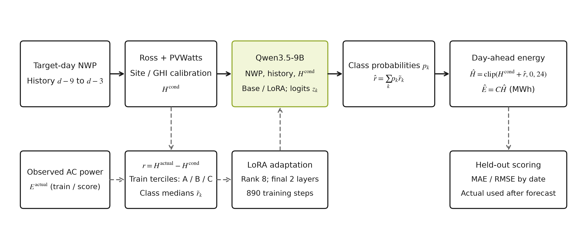
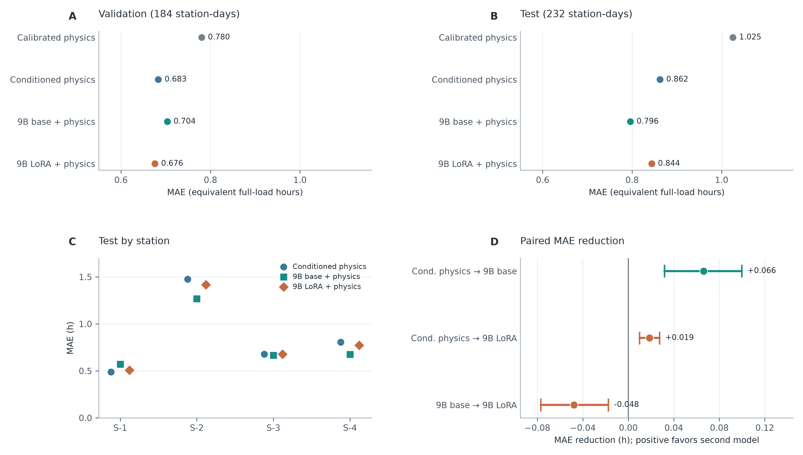

# 物理模型与大语言模型结合的日前光伏发电量预测研究

本仓库的 `research/ollama-pv-paper` 分支用于人工智能课程论文及本课题组**探索者计划项目**的光伏预测拓展研究。研究对象是河北四座公开光伏电站的**次日总发电量**：用数值天气预报驱动物理模型，再检验 9B 大语言模型能否修正剩余误差。线上日、月预测演示保留在 [`main` 分支](https://github.com/lowayforest/energy-forecast-ai/tree/main)；本分支记录论文、实验代码、方案和结果。

论文终稿：[《物理模型与大语言模型结合的日前光伏发电量预测研究》](reports/research_paper_final.md) · [研究日志](reports/research_log.md) · [参考文献核查](reports/research_references.md)



## 研究问题与方法

核心问题是：**在相同物理预测基础上，微调后的 9B 模型能否比未微调基座更准确地预测未来日期的日发电量？**

1. 将 15 分钟交流功率积分为日发电量；按额定容量换算为等效满负荷小时，以便比较不同容量的电站。
2. 使用目标日数值天气预报（NWP）的辐照度和气温，经 Ross 组件温度模型与 PVWatts 功率近似得到物理预测；仅用训练期估计站点比例与高、低辐照度条件偏差。
3. 用条件物理预测作锚点，把剩余误差分为 A/B/C 三档。Qwen3.5-9B 的四位量化模型通过 MLX-LM 训练 rank 8 LoRA；推理时以三档概率加权训练期残差中位数，恢复连续修正量。
4. 对照原校准物理、条件物理、同权重未微调 9B 基座及 LoRA 模型；报告按日期划分的验证和测试结果。历史零样本、连续残差、类别损失消融及 XGBoost 探索也保留在研究记录中。

预测输入只使用目标日的 `nwp_*` 字段和目标日前 9 至 3 天的七个完整日历史发电量；目标日 `power` 和现场实测 `lmd_*` 只用于制作标签或事后分析。整理后的 CSV 缺少逐条 NWP **发布时间**，因此无法逐条核验固定日前时点的可用性，复现时应保留这一限制。

## 数据与实验划分

- 数据：[PVOD 原始数据](https://github.com/yaotc/PVODataset)经 [AI-PVOD 整理的四站数据](https://huggingface.co/datasets/yujiaA/AI-PVOD/tree/main)，站点位于河北，容量分别为 6.6、20、20、20 MW；**没有使用上海场站数据**。
- 从 1,346 个完整站点日构建 1,310 条带历史窗口的样本。按北京时间日期划分：训练 890 条（至 2019-02-28）、验证 184 条（2019-03-01 至 04-15）、测试 236 条（2019-04-16 至 06-13）。同一日期的四站不会跨集合。
- 主测试评分排除曾在评分前意外看到一条标签的 **2019-04-16 整日四站**，使用之后 58 天、232 条样本；完整 236 条结果仅作补充。验证集经历多轮方法探索，后续消融也已查看旧测试集，不应把旧测试再次当作新独立评估。
- 原始 ZIP、处理数据、模型权重、adapter 和日志均在 Git 忽略的 `data/` 下。数据与模型版本、校验值见[数据核查](reports/research_dataset_selection.md)、[逐日数据构造](reports/research_daily_dataset.md)、[模型及训练记录](reports/research_qlora_feasibility.md)。

## 主要结果

误差单位为**等效满负荷小时（h）**；具体站点的日发电量（MWh）由预测小时数乘以该站额定容量（MW）得到。下表为主测试期 232 条样本的既有、冻结方案结果：

| 方法 | MAE（h） | RMSE（h） |
| --- | ---: | ---: |
| 原校准物理 | 1.0253 | 1.3507 |
| 条件物理 | 0.8622 | 1.1376 |
| 未微调 9B 基座 + 条件物理 | **0.7960** | **1.0441** |
| LoRA 微调 9B + 条件物理 | 0.8437 | 1.1110 |

LoRA 模型比条件物理的 MAE 低 0.0185 h，**但比未微调基座高 0.0477 h**。验证期 LoRA 的 MAE 为 0.6757 h，基座为 0.7035 h；这一排序没有保持到主测试期。结论是该实验尚未证明微调带来稳定增益，也不能据此声称适用于上海场站。逐站误差、成对日期块区间与失败原因见[最终测试记录](reports/research_final_test_results.md)和[论文讨论](reports/research_paper_final.md#5-讨论)。



## 复现

实验使用 Python 3.12，模型训练与推理使用 Apple Silicon 上的 MLX-LM 0.32.2；`requirements-research.txt` 固定主要 Python 包版本。9B 权重和完整训练会占用较多内存，原实验设备为 16 GB Apple M5。XGBoost 在 macOS 上还需要系统提供 OpenMP 运行库。以下命令从仓库根目录执行：

```bash
uv venv --python 3.12 .venv
uv pip install --python .venv/bin/python -r requirements-research.txt
mkdir -p data/raw/research
curl -L --fail --retry 3 \
  https://huggingface.co/datasets/yujiaA/AI-PVOD/resolve/main/full_dataset.zip \
  -o data/raw/research/ai_pvod_full_dataset.zip
shasum -a 256 data/raw/research/ai_pvod_full_dataset.zip
```

原始 ZIP 的预期 SHA-256 为 `ba0639dc3c69c49b425f36877e5aa8f2923ca5d1fff6ca9a76a5aed17ba53383`。核对后构造数据与物理基线：

```bash
.venv/bin/python scripts/audit_research_dataset.py
.venv/bin/python scripts/build_research_daily.py
.venv/bin/python scripts/build_research_physics.py
.venv/bin/python scripts/build_research_conditional.py
.venv/bin/python scripts/build_research_sft_v2.py
```

按[模型下载与权重校验记录](reports/research_qlora_feasibility.md#模型下载与样本长度)下载 `mlx-community/Qwen3.5-9B-4bit` 指定 revision 到 `data/cache/research/mlx_qwen35_9b_4bit/`，再运行：

```bash
bash scripts/run_research_v3.sh
.venv/bin/python scripts/prepare_research_final_test.py
.venv/bin/python scripts/evaluate_research_final_test.py --variant base
.venv/bin/python scripts/evaluate_research_final_test.py --variant adapter
.venv/bin/python scripts/score_research_final_test.py
.venv/bin/python scripts/plot_research_main_results.py
```

`run_research_v3.sh` 只完成 v3 训练与**验证集**评估；后续命令才生成测试预测与评分。最终测试脚本会检查模型、输入与 adapter 的哈希，并支持已有预测的续跑。具体规则及执行顺序见[冻结测试方案](reports/research_final_test_protocol.md)。图 1 的代码是 `scripts/plot_research_method.py`，图 2 的代码是 `scripts/plot_research_main_results.py`。

## 仓库内容

- `reports/research_paper_final.md`：课程论文终稿，包含公式、方法、结果、局限和 15 条参考文献。
- `reports/research_log.md` 与 `reports/research_*.md`：每步实验方案、数据校验、结果和后续数据需求。早期方案记录的是当时的计划；最终结论以论文和冻结测试报告为准。
- `prompts/research_*.md`：零样本、连续残差及分档任务的提示词。
- `scripts/*research*`：数据审计、物理预测、样本构造、训练、评分、分析和作图脚本。
- `reports/figures/`：论文方法图、结果图及绘图数据；`data/` 为本地生成内容，不纳入版本控制。

研究分支地址：<https://github.com/lowayforest/energy-forecast-ai/tree/research/ollama-pv-paper>。本研究是探索者计划项目的课程论文拓展，当前公开数据结果用于研究方法与误差；未来实际场站应用仍需可核验发布时间的天气预报、设备参数与独立的新时段数据。
