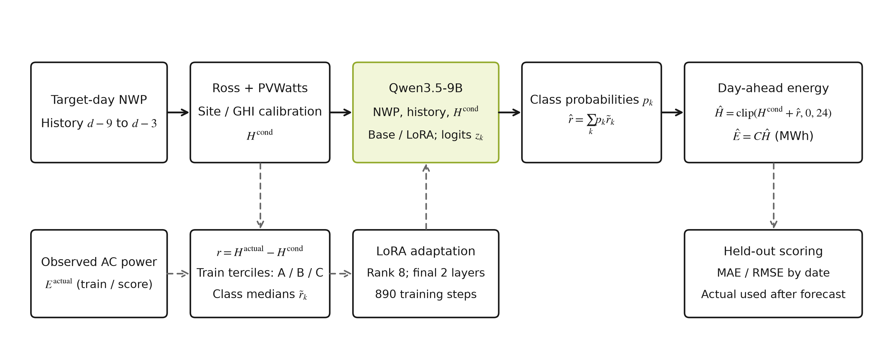
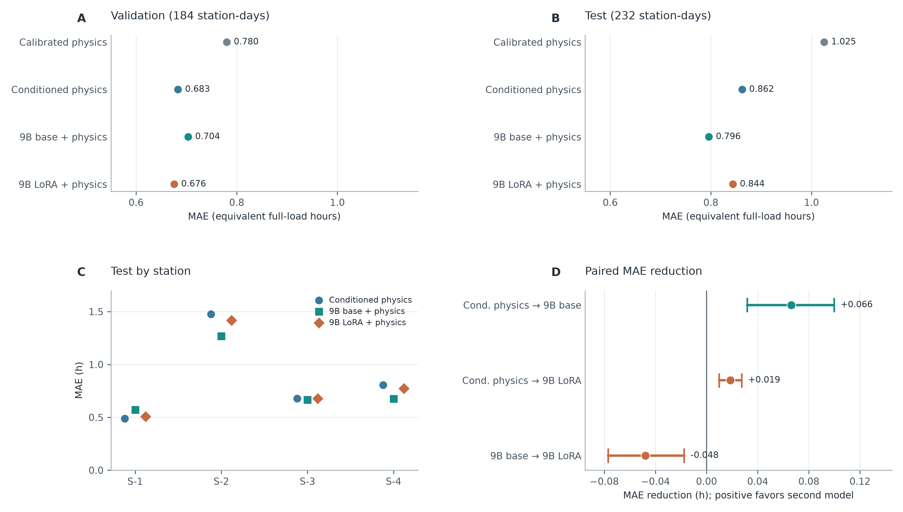

# 物理模型与大语言模型结合的日前光伏发电量预测研究

## 摘要

日前光伏发电量预测需要利用提前获得的天气预报，同时面对场站参数不完整和天气预报误差。本文以公开的河北四座光伏电站为对象，研究物理模型与大语言模型结合的预测方法。先用数值天气预报驱动 Ross 组件温度模型和 PVWatts 功率近似，再用训练期数据校正场站及辐照度条件偏差；在此基础上，将剩余误差划分为三类，由 Qwen3.5-9B 预测类别概率并恢复连续修正量。研究按时间划分 890 条训练、184 条验证和 236 条测试样本，并比较原物理模型、条件物理模型、未微调 9B 基座和低秩微调模型。排除评分前意外暴露一条标签所在的完整日期后，232 条主测试样本上，条件物理、未微调基座和微调模型的等效满负荷小时 MAE 分别为 0.8622、0.7960 和 0.8437 h。微调模型优于条件物理，但未超过基座；验证期的微小收益也没有保持到测试期。进一步消融表明，仅改变类别训练损失并未解决跨时期泛化问题。本文据此分析物理偏差、离散残差表示与样本规模对结果的影响，为后续数据收集和模型改进提供可复核的依据。

**关键词：**光伏发电量预测；日前预测；物理模型；大语言模型；低秩微调；残差修正

## 1 引言

光伏电站次日能发多少电，很大程度上取决于次日的辐照度和天气。实际预测时，未来的真实天气与发电量还没有发生，模型只能使用当时已经发布的天气预报，以及此前的发电记录。本文关注的是“在日前给出次日总发电量”，不是用目标日的实测天气回算发电量，也不是预测每个 15 分钟时刻的功率。前者更接近一个明确的运行任务，后者若没有时间边界，容易得到看似不错却无法真正提前使用的结果。

现有方法各有侧重。物理模型从辐照度、组件温度和额定容量推算功率，结构清楚，但需要组件倾角、方位、损耗等参数；参数不全时只能用近似值。统计模型和树模型可以从历史发电与天气字段学习非线性关系，通常需要足够多且跨季节的数据。光伏预测综述对这些方法及预测尺度作过梳理[3]，基于数值天气预报的机器学习比较也说明传统模型应作为大模型实验的对照[4]。近期的 Cross-Unet 研究强调历史功率与未来天气的联合使用[2]，但其任务是多时刻功率序列预测，不能把论文中的数值直接拿来与本文的日发电量误差比较。

日发电量看似只是把功率曲线积分，实际会把多种误差混在一起：天气预报偏差、组件模型偏差和停机限电都会改变一天的总量。本文没有足够的设备状态信息把它们逐项分开，所以采用“物理预测给出合理量级，模型只预测剩余误差”的结构。这样的结构也便于分别检查物理层和大模型层，而不是在一个端到端输出中推测某个模块为何有效。

把语言模型用于数值预测并不必然有效。已有研究指出，数字如何拆分为 token 会影响预测[9]；Chronos 则通过缩放、量化和预训练，专门学习时间序列的 token 表示[11]。另一方面，针对语言模型时间序列方法的消融研究发现，若缺少强对照，模型结构本身的贡献容易被高估[12]。这些工作给本文两点启发：残差可以尝试离散表示，但仍须比较物理基线和同一 9B 模型的未微调版本。本文的核心问题是：**在相同物理预测基础上，低秩微调后的 9B 模型是否比未微调基座更能降低未来时间段的日发电量误差？**

为回答这个问题，本文构建一个可解释的天气驱动物理锚点，并让大模型预测该锚点尚未解释的剩余误差。实验不仅报告验证集上的表现，还保留按时间较晚的测试期、逐站误差及成对日期块区间。研究目标是分析方法在这份数据上的表现与失败原因，不预设大模型一定优于较简单的方法。

## 2 数据与预测任务

### 2.1 数据来源与日发电量标签

数据来自 PVOD 原始数据集[1]经 AI-PVOD 研究整理的四站 CSV[2]。四座电站位于河北，额定容量依次为 6.6、20、20 和 20 MW。原始记录以北京时间每 15 分钟给出一次交流功率，同时包含数值天气预报（NWP）和现场实测天气（LMD）。逐日审计后，各站共有 1,346 个完整日期；扣除构建历史窗口所需的开头日期，得到 1,310 个站点日样本。原始数据来源、字段与文件校验值保存在实验记录中。

设电站 $s$ 的额定容量为 $C_s$，日期 $d$ 的 15 分钟实际功率为 $P_{s,i}^{\mathrm{actual}}$，则日发电量和等效满负荷小时为

$$E_{s,d}=0.25\sum_{i\in d}P_{s,i}^{\mathrm{actual}},\qquad H_{s,d}=E_{s,d}/C_s.$$

$P$ 的单位是 MW，$E$ 的单位是 MWh，$H$ 的单位是 h。用 $H$ 评价四站，可以避免容量不同直接造成的误差尺度差异；最后再乘以容量得到日发电量。所有方法都预测同一组站点日，不随机打散 15 分钟记录。训练集截至 2019 年 2 月 28 日，包含 890 条；验证集为 2019 年 3 月 1 日至 4 月 15 日，184 条；测试集为 4 月 16 日至 6 月 13 日，236 条。四站的同一日期始终属于相同时间段。

### 2.2 日前可用信息与数据边界

目标日输入取 CSV 中的 `nwp_*` 天气预报，包括辐照度、温度、湿度和风速的日汇总。历史发电量只取目标日 $d-9$ 至 $d-3$ 的七个完整日。该窗口留出两天缓冲，减少误把尚未完整形成的最近发电数据当作已知输入的风险。目标日功率和 `lmd_*` 现场实测天气只用于形成标签或事后分析，不进入提示词与预测特征。

数据切分后，模型面对的天气范围并不完全相同。验证期的 NWP 日 GHI 均值约为 5.0097 kWh/m²，主测试期约为 5.8668 kWh/m²；而训练期均值约为 3.1226 kWh/m²。这不是人为制造的分布变化，而是按时间划分后自然出现的季节差异。它提示验证期得到的校正幅度可能不适合更晚的月份，也是本文坚持保留时间顺序的原因。

PVOD 原论文介绍了逐日运行的天气预报及约 28—54 小时的提前量[1]。不过，整理后的 CSV 只保存预报的目标时刻，没有每一条预报的发布时刻。因此，本文按原数据说明把 `nwp_*` 视为前瞻天气输入，不能声称已逐条核验其在固定日前时点确实可得。这一限制比一般的缺失值问题更重要：若误用目标日实测天气，实验任务就不再是日前预测。

## 3 方法

### 3.1 天气驱动的物理预测

物理部分使用 `pvlib` 实现的 Ross 组件温度关系和 PVWatts 直流功率近似[5]、[6]。设 $G_{s,i}$ 为 NWP 给出的水平面总辐照度（W/m²），$T_{s,i}^{\mathrm{air}}$ 为预报气温（°C），先计算

$$T_{s,i}^{\mathrm{cell}}=T_{s,i}^{\mathrm{air}}+\frac{45-20}{800}G_{s,i},$$

$$P_{s,i}^{\mathrm{dc}}=C_s\frac{G_{s,i}}{1000}\left[1-0.004\left(T_{s,i}^{\mathrm{cell}}-25\right)\right].$$

这里把 NOCT 设为 45 °C、功率温度系数设为 $-0.004\,\mathrm{°C}^{-1}$，再用 0.96 作为固定的交流转换系数，对每个时刻的输出裁剪至 $[0,C_s]$，并按 0.25 h 积分。实际 PVWatts 更适合使用阵列平面有效辐照度；本数据缺少可靠的倾角、方位、组件和逆变器参数，只能用 GHI 作代理。这些数值是统一实验假设，不能被解释为四站的真实设备参数。

统一假设仍会形成站点偏差。本文在训练期中，对原始物理预测至少达到 $0.1C_s$ MWh 的日期，计算实测发电量与原始预测之比，并取中位数作为站点比例 $a_s$：

$$a_s=\operatorname{median}_{d\in\mathcal T_s}\frac{E_{s,d}^{\mathrm{actual}}}{E_{s,d}^{\mathrm{raw}}},\qquad H_{s,d}^{\mathrm{phys}}=\frac{\min(a_sE_{s,d}^{\mathrm{raw}},24C_s)}{C_s}.$$

$a_s$ 吸收了辐照度代理、设备效率及场站运行状态等多个未建模因素，因此不是一个可以直接解释的“系统损耗率”。站点比例只由训练期拟合，并固定用于验证和测试。

对小时或 15 分钟功率做物理计算，再汇总成日能量，比直接把日累计辐照度代入一个线性式更接近实际计算流程。温度会随时刻变化，输出还受到额定功率上限约束。不过，本研究的逆变器部分仍是固定比例和裁剪，没有精细模拟转换效率曲线；这种简化在跨站比较中尤其需要说明。

### 3.2 条件物理校正

训练期的 NWP 日 GHI 上三分位为 3.5408 kWh/m²。以这个阈值区分高、低辐照度，在每座电站的每个组内求“真实等效小时减物理预测”的训练均值 $m_{s,b}$，得到

$$m_{s,b}=\frac{1}{|\mathcal T_{s,b}|}\sum_{d\in\mathcal T_{s,b}}\left(H_{s,d}^{\mathrm{actual}}-H_{s,d}^{\mathrm{phys}}\right),\qquad H_{s,d}^{\mathrm{cond}}=\operatorname{clip}\left(H_{s,d}^{\mathrm{phys}}+m_{s,b},0,24\right).$$

这种校正补偿不同站点在高、低辐照条件下的平均误差，属于统计校准，不是新的物理定律。构造训练样本的大模型目标时，用同组留一均值计算该样本的物理锚点，避免本条标签直接进入自己的均值；验证和测试只使用完整训练组的均值。把校正层与后续大模型层分开评价，才能看出增益来自哪里。

### 3.3 大语言模型的剩余误差预测

目标残差为 $r_{s,d}=H_{s,d}^{\mathrm{actual}}-H_{s,d}^{\mathrm{cond}}$。让语言模型直接生成带小数的残差时，前期实验出现输出集中在少数小幅修正附近的问题。本文因此只用训练期残差的三分位设置 A、B、C 三档，边界分别为 $-0.3944$ h 和 $+0.3250$ h；三档训练样本数为 297、296、297。各档训练残差中位数依次为 $-0.8728$、$-0.0215$、$+0.8141$ h。这个设计受数值 token 化工作的启发[9,11]，但只是一个小样本分类任务，并不等同于训练了专门的时间序列基础模型。

模型采用 Qwen3.5-9B 的四位量化权重[13]，通过 MLX-LM 在最后两层训练 rank 8 LoRA adapter。LoRA 用低秩矩阵表示冻结权重上的可训练增量[7]；量化基座上训练 adapter 与 QLoRA 的研究方向有关[8]，但这里没有复现 QLoRA 论文中的全部量化和优化器细节。实际可训练参数约 132.8 万，占总参数约 0.015%。提示词输入包括电站、目标日期、目标日 NWP 汇总、七天历史发电量和条件物理等效小时，不含目标日实测功率。A/B/C 都是单个 token，最终 adapter 使用 batch 1、学习率 $10^{-5}$、随机种子 42，完成 890 次参数更新。

推理时读取首个回答 token 对 A/B/C 的三个 logit $z_k$，只在这三类中做 softmax，用类别概率加权训练期中位数：

$$p_k=\frac{\exp(z_k)}{\sum_{j\in\{A,B,C\}}\exp(z_j)},\qquad \widehat r_{s,d}=\sum_{k\in\{A,B,C\}}p_k\widetilde r_k,$$

$$\widehat H_{s,d}=\operatorname{clip}\left(H_{s,d}^{\mathrm{cond}}+\widehat r_{s,d},0,24\right),\qquad \widehat E_{s,d}=C_s\widehat H_{s,d}.$$

这种概率是三类受限归一化的输出，不应理解为对任意残差值已经校准的概率。图 1 展示了推理流程与训练标签的边界。未微调基座使用同一量化权重、提示和解码规则，只是不加载 adapter，因此它是检验微调是否有额外作用的必要对照。

三档表示降低了自由生成小数的难度，也丢失了档内差异。若某天真实误差落在 A 档的极端位置，用该档中位数还原会低估误差幅度；若三个类别的概率接近，连续修正又会被平均到中间。由此可见，分类准确率和日发电量 MAE 不一定同步变化，评价时仍须把类别指标和最终能量误差分开报告。

图 1 预测时使用目标日 NWP、较早的历史发电和训练期拟合的物理参数。下方虚线表示仅在训练或事后评分中使用目标日实测发电量；图中模型对应最终 v3 adapter。

### 3.4 评价方式

记预测误差 $e_j=\widehat H_j-H_j$。本文报告 MAE、RMSE 和平均偏差，分别反映平均绝对误差、较大误差的影响以及系统高估或低估[14]：

$$\mathrm{MAE}=\frac1N\sum_j|e_j|,\qquad \mathrm{RMSE}=\sqrt{\frac1N\sum_j e_j^2},\qquad \mathrm{Bias}=\frac1N\sum_j e_j.$$

同日四站可能受到相似天气影响，不能简单把全部站点日当作互不相关样本。比较两种方法的绝对误差时，以日期为块进行 10,000 次有放回重采样，取改善量的 2.5% 和 97.5% 分位[15]。这个区间只描述本次日期块重采样的波动；它没有处理相邻日期的时间相关，也不是跨地区泛化的保证。

## 4 实验与结果

### 4.1 对照设置和实验边界

对照依次包括原校准物理、条件物理、同一分档提示下未微调的 9B 基座，以及 890 步微调 adapter。物理部分与分档边界只用训练集拟合；验证集用于方法探索，原测试集在方案和权重冻结后评分。作为较小机器学习模型的补充，另使用 XGBoost[10]按训练期四个滚动时间折选择配置，再查看春季验证表现。该对照是在原最终测试评分后设计的探索实验，没有新的独立测试分数，不能据此得出“大模型优于传统机器学习”的普遍结论。

实验在配备 16 GB 统一内存的 Apple M5 设备上运行，使用 MLX-LM 0.32.2。初次 9B 长训练曾在开始阶段因 Metal 内存不足停止。缩短提示词后完成全部 890 步，最长训练样本控制在 400 token 以内。模型输出均为可用的类别概率，验证和测试推理没有触发回退。实验代码、数据来源与预测文件的 SHA-256 保存在研究分支记录中；较大的原始 CSV 和模型权重没有提交到 Git 仓库。

### 4.2 验证集表现

表 1 给出 184 条验证样本的结果。条件物理相较原物理，MAE 从 0.7802 降至 0.6834 h，是最明显的一步改善。微调 9B 在条件物理之上又降至 0.6757 h，只改善 0.0077 h，约 28 秒；按 46 个日期块重采样，改善区间为 $[-0.0058,+0.0202]$ h，跨过零。因而此处只能说观察到小幅点估计改善，不能说已证实稳定提升。

| 方法 | MAE（h） | RMSE（h） |
|:--|--:|--:|
| 原校准物理 | 0.7802 | 0.9864 |
| 条件物理 | 0.6834 | 0.8534 |
| 连续小数残差 9B adapter | 0.7083 | 0.8725 |
| 分档任务未微调 9B 基座 | 0.7035 | 0.8712 |
| 分档任务最终 9B adapter | **0.6757** | **0.8444** |

表 1 验证期不同方法的等效满负荷小时误差

前一轮让 9B 自由生成小数残差，MAE 为 0.7083 h，高于条件物理。分档任务的结果较好，说明在这组提示与训练条件下，限制输出形式有一定作用；但它同时改变了残差表示和训练步数，不能把两轮差值全部归因于分档本身。训练语言损失下降也不等同于发电量预测精度提高，因为早期损失还包括容易预测的回复结构 token。后续只监督 A/B/C 类别 token 的消融将在 4.4 节讨论。

逐站验证结果也没有表现为一致改善。S-2 上基座 MAE 为 0.6818 h，低于最终 adapter 的 0.7567 h；S-1 上则相反，基座为 0.7389 h，adapter 为 0.6206 h。整体 MAE 是四站样本的平均，站点间相反的变化会相互抵消。这为后面的测试期分析提供了线索：如果一个方法只是改变平均修正方向，整体排序会随站点和月份的组成而变化。

### 4.3 原先冻结方案的测试结果

编写最终测试方案前，检查文件结构时意外看到 2019 年 4 月 16 日 S-1 的一条真实标签。模型和规则此前已确定，也未根据该标签调参；为了保守，评分前写明从主结果中排除这一天的完整四站块。因此主测试使用 2019 年 4 月 17 日至 6 月 13 日的 58 天、232 条样本，全部 236 条结果仅作补充。这个处理不能消除所有研究过程中的选择影响，但避免把已见标签称为完全未见。

| 方法 | MAE（h） | RMSE（h） | 平均偏差（h） |
|:--|--:|--:|--:|
| 原校准物理 | 1.0253 | 1.3507 | +0.5715 |
| 条件物理 | 0.8622 | 1.1376 | +0.4520 |
| 未微调 9B 基座 + 条件物理 | **0.7960** | **1.0441** | +0.2180 |
| 最终 9B adapter + 条件物理 | 0.8437 | 1.1110 | +0.4247 |

表 2 主测试期 232 个站点日的预测误差

最终 adapter 比条件物理的 MAE 低 0.0185 h，日期块区间为 $[+0.0098,+0.0275]$ h；但它比未微调基座高 0.0477 h，对应“adapter 相对基座的改善”区间为 $[-0.0770,-0.0175]$ h。基座在这段时间是四种既有方法中误差最低的一个。若包含首日，条件物理、基座和 adapter 的 MAE 分别为 0.8737、0.8071、0.8558 h，方法排序不变。图 2 把合并误差、逐站结果与成对改善放在一起，避免只看一个平均值。

图 2 A、B 为验证期和主测试期合并 MAE；C 为主测试期逐站 MAE；D 中正值表示箭头右侧方法误差更低，横线为 58 个日期块、10,000 次重采样的描述性 95% 区间。图只展示原先冻结的 v3 测试比较。

逐站看，S-2 是主测试期最大的误差来源：条件物理、基座和 adapter 的 MAE 分别为 1.4755、1.2684 和 1.4163 h。S-1 上基座比条件物理差，S-3 和 S-4 则略好或明显更好。四站平均的优势因此不能解释为“每座电站都受益”。另一点是时间段差异：验证期条件物理平均偏差为 +0.0340 h，主测试期升至 +0.4520 h，说明物理锚点在较晚阶段明显高估。

### 4.4 补充消融与传统模型对照

为核查类别学习是否被模板标记的训练损失掩盖，原测试评分后重新训练一版只对 A/B/C token 计算损失的 v4 adapter。模型、样本、提示、LoRA 配置和 890 步更新与前版相同。v4 在验证期 MAE 为 0.6774 h，略高于 v3 的 0.6757 h；完整验证集三类受限交叉熵也由 1.0856 变为 1.0935，未改善。旧测试 232 条上的回顾性 MAE 为 0.8422 h，与 v3 的 0.8437 h 接近，仍高于基座 0.7960 h。由于旧测试此时已用于分析，v4 数字不能当作新独立测试结果。它说明修正损失目标是实现上的改进，却没有解决当前数据上的泛化问题。

XGBoost 使用天气、历史发电及物理预测等特征，在训练期四个滚动折上选择深度 3、学习率 0.05、200 棵树，四折平均 MAE 为 0.7057 h；用全部训练期拟合后，春季验证 MAE 为 0.8776 h，平均偏差为 $-0.5904$ h。这个具体模型明显低估，但它的训练目标、输入表达和调参空间与 9B 不同，不能据此否定所有树模型。另一个训练期滚动实验尝试按站点与辐照组拟合残差斜率，四折平均 MAE 仅从 0.8589 降至 0.8523 h，未达到事先设定的 0.01 h 选用门槛，因而保留原条件物理模型。这些负结果使后续优化方向更明确：不能依靠在旧测试期上反复调固定偏移来制造提升。

## 5 讨论

### 5.1 为什么微调没有稳定超过基座

两个时期的模型排序不同，与平均偏差变化有关。主测试期，真实值减条件物理预测的平均残差为 $-0.4520$ h；未微调基座平均给出约 $-0.2340$ h 的修正，v3 adapter 只给出约 $-0.0273$ h。基座较大的负修正在这一段时间恰好更能抵消物理高估。验证期真实剩余残差均值约为 $-0.0340$ h，v3 的平均修正也接近这个数，所以验证期排序恰好相反。两段同时发生的辐照度和残差变化，不能证明某一个天气变量单独导致了模型排序反转。

模型对逐日变化的辨别仍弱。主测试期真实剩余残差标准差约 1.0439 h，基座和 adapter 给出的修正标准差分别只有 0.0762 和 0.0648 h，输出更像平缓的平均校正。三档中位数虽然提供了约 $-0.87$ 至 $+0.81$ h 的还原范围，但三类概率接近时，加权结果仍集中于零附近。验证期 v3 的三类交叉熵为 1.0856，与三类均匀预测的 $\ln 3\approx1.0986$ 很接近。训练样本只有 890 个站点日，且跨站、跨季节条件变化明显，这些数字提示类别信号没有被充分学到；它们不证明增加模型规模或训练步数就一定无用。

### 5.2 研究限制与项目延伸

物理层没有阵列倾角、方位和真实组件参数，用 GHI 代理组件面辐照度；同一组简化参数不可能完整反映四座电站的运行状态。整理数据也缺少逐条 NWP 发布时间，严格的日前可用性只能依据原数据说明，而非逐条审计。四站都位于河北，时间覆盖不到两年，没有上海场站的独立验证。验证期被多轮方法探索反复使用，统计区间可能偏乐观；原测试后来也用于错误分析，不应再拿它作为新方法选型后的独立确认。

本研究是本课题组探索者计划项目中光伏发电预测任务的一项拓展。项目中的原型工作关注日、月发电量预测的展示与实现，本课程论文把其中的日前日发电量问题单独拿出来，补上物理公式、训练期参数估计、可复现的 9B 微调，以及按时间划分的模型对照。当前结果可以支撑方法可行性与误差分析，不能据此宣称项目已经具备上海场站的部署精度，也不能把逐日滚动相加得到的月累计预测写成“月初一次性预测整月”。

如果项目进入实际场站应用，最先需要明确的并不是换一个更大的模型，而是每条天气预报在何时发布、目标站点是否发生限电或检修、容量是否变更。这些信息决定了样本的输入能否提前获得，也决定了某次低发电量究竟是天气造成还是设备运行造成。缺少它们时，即使在公开数据上把 MAE 再压低一些，也不能直接推断真实部署效果。

研究代码、预先固定的实验方案、图表脚本和结果记录位于 [GitHub 项目研究分支](https://github.com/lowayforest/energy-forecast-ai/tree/research/ollama-pv-paper)。原始数据和大体积权重没有提交到仓库，文档记录了下载来源、版本和 SHA-256。后续若拿到项目场站的数据，应先明确 NWP 发布时间、停机和限电标记、组件与逆变器参数，并预留新的未见时间段；再在训练期内部比较更完整的物理模型、常规机器学习和大模型残差表示。这样才能判断微调的收益是否真实可重复。

## 6 结论

在四座河北光伏电站的日前日发电量任务上，训练期条件校正使原物理模型的主测试 MAE 从 1.0253 降至 0.8622 h。相同物理锚点之上，未微调 9B 基座达到 0.7960 h，分档残差微调模型为 0.8437 h。微调模型比条件物理略好，但没有超过基座；验证期的微小优势没有在较晚的测试期保持。只监督类别 token 的消融也未改变这一判断。现阶段最有价值的结果是明确了物理锚点、模型训练目标和跨时期偏差各自的作用边界。新的精度主张需要更完整的场站与天气预报数据，并在新独立时间段上重新检验。

## 参考文献

[1] Yao T, Wang J, Wu H, et al. A photovoltaic power output dataset: Multi-source photovoltaic power output dataset with Python toolkit[J]. Solar Energy, 2021, 230: 122-130. DOI: 10.1016/j.solener.2021.09.050.

[2] Zhang Y, Zhang Y, Dai Z, Zhang R. Rethinking the use of deep learning methods for photovoltaic power forecasting[J]. Nature Communications, 2026, 17: 7613. DOI: 10.1038/s41467-026-73817-3.

[3] Antonanzas J, Osorio N, Escobar R, et al. Review of photovoltaic power forecasting[J]. Solar Energy, 2016, 136: 78-111. DOI: 10.1016/j.solener.2016.06.069.

[4] Markovics D, Mayer M J. Comparison of machine learning methods for photovoltaic power forecasting based on numerical weather prediction[J]. Renewable and Sustainable Energy Reviews, 2022, 161: 112364. DOI: 10.1016/j.rser.2022.112364.

[5] Dobos A P. PVWatts Version 5 Manual[R]. NREL/TP-6A20-62641, 2014. DOI: 10.2172/1158421.

[6] Holmgren W F, Hansen C W, Mikofski M A. pvlib python: a python package for modeling solar energy systems[J]. Journal of Open Source Software, 2018, 3(29): 884. DOI: 10.21105/joss.00884.

[7] Hu E J, Shen Y, Wallis P, et al. LoRA: Low-Rank Adaptation of Large Language Models[C]. ICLR, 2022. https://arxiv.org/abs/2106.09685.

[8] Dettmers T, Pagnoni A, Holtzman A, Zettlemoyer L. QLoRA: Efficient Finetuning of Quantized LLMs[C]. NeurIPS, 2023. https://proceedings.neurips.cc/paper_files/paper/2023/hash/1feb87871436031bdc0f2beaa62a049b-Abstract-Conference.html.

[9] Gruver N, Finzi M, Qiu S, Wilson A G. Large Language Models Are Zero-Shot Time Series Forecasters[EB/OL]. arXiv:2310.07820, 2023. https://arxiv.org/abs/2310.07820.

[10] Chen T, Guestrin C. XGBoost: A Scalable Tree Boosting System[C]. KDD, 2016: 785-794. DOI: 10.1145/2939672.2939785.

[11] Ansari A F, Stella L, Turkmen C, et al. Chronos: Learning the Language of Time Series[EB/OL]. arXiv:2403.07815, 2024. https://arxiv.org/abs/2403.07815.

[12] Tan M, Merrill M A, Gupta V, Althoff T, Hartvigsen T. Are Language Models Actually Useful for Time Series Forecasting?[EB/OL]. arXiv:2406.16964, 2024. https://arxiv.org/abs/2406.16964.

[13] Qwen Team. Qwen3.5-9B model card[EB/OL]. 2026. https://huggingface.co/Qwen/Qwen3.5-9B.

[14] Hyndman R J, Koehler A B. Another look at measures of forecast accuracy[J]. International Journal of Forecasting, 2006, 22(4): 679-688. DOI: 10.1016/j.ijforecast.2006.03.001.

[15] Efron B. Bootstrap Methods: Another Look at the Jackknife[J]. The Annals of Statistics, 1979, 7(1): 1-26. DOI: 10.1214/aos/1176344552.
