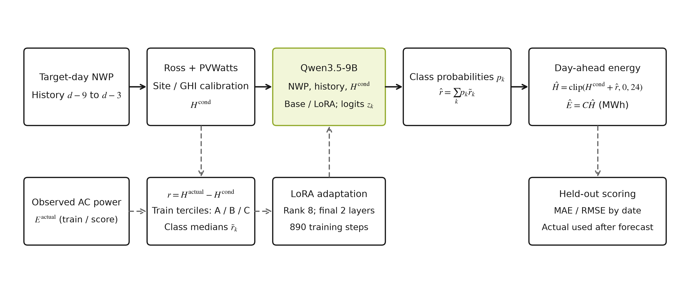
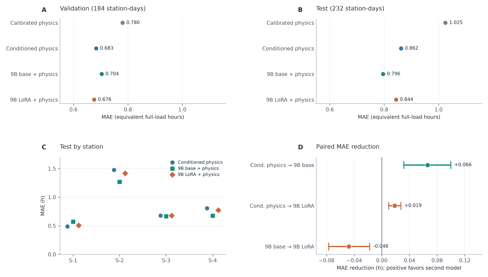

# 物理模型与大语言模型结合的日前光伏发电量预测研究

## 摘要

本文研究四座河北光伏电站的次日总发电量预测。数据中有数值天气预报和 15 分钟功率记录，但缺少完整的设备参数，也没有逐条预报发布时间。我们先根据 Ross 温度模型和 PVWatts 功率近似计算日发电量，用训练期数据校正站点及辐照度条件偏差；再把未解释的误差分为三档，由 Qwen3.5-9B 输出各档概率并还原为连续修正量。按日期得到训练、验证、测试样本分别为 890、184、236 条。主测试排除评分前曾意外看到一条标签的整日数据，剩余 232 条样本上，条件物理模型、未微调 9B 基座和 LoRA 微调模型的等效满负荷小时 MAE 分别为 0.8622、0.7960、0.8437 h。微调模型相对条件物理模型有小幅改善，却没有超过同一权重的未微调基座；验证期的排序也未延续到测试期。只监督类别 token 的补充实验没有改变这一结果。论文重点讨论这种排序变化与物理预测偏差、残差分档及样本规模的关系，而不把微调视为必然有效的步骤。

**关键词：**光伏发电量预测；日前预测；物理模型；大语言模型；低秩微调；残差修正

## 1 引言

本文把任务限定为在目标日到来之前估计该日的总发电量。这个限定决定了输入的选择：可以使用未来日的天气预报和此前的发电记录，不能把目标日现场观测或实际功率放进预测特征。它也决定了评价对象是一天的电量，而不是 15 分钟功率曲线。若不先说明预测时点，把目标日实测辐照度输入模型再计算误差，得到的只是事后估计，不能解释为日前预测。

从辐照度推算功率有一条清楚的物理计算路径：估计组件温度，再根据额定容量和温度系数求输出。问题在于公开数据未必给出倾角、方位和真实损耗。另一条路径是让统计模型学习天气与历史发电之间的关系，但跨季节使用时需要检查训练样本是否覆盖了相应条件。相关综述整理了预测尺度与方法[3]，数值天气预报驱动的机器学习比较提供了传统模型对照的依据[4]。Cross-Unet 同时使用历史功率和未来天气[2]；它预测的是多个时刻的功率序列，误差口径与本文的日发电量不同，不能直接比较数字大小。

把 96 个 15 分钟功率值加总后，误差并不会自动变得容易解释。同样是日发电量偏低，原因可能是云量预报偏差，也可能是组件效率、停机或限电。现有字段无法把这些原因逐项识别出来。本文让物理计算承担数量级估计，再让语言模型处理剩余误差，并分别给两部分评分。这样至少可以判断最终变化发生在物理校正之前还是之后。

语言模型处理数值有一个具体困难：相近的小数可能被切成不同的 token 序列，生成过程未必保留连续数值之间的距离[9]。Chronos 为时间序列设计了缩放和量化方案[11]，但这与直接微调通用语言模型是两种任务设置。另有消融研究提醒，时间序列方法若没有足够强的对照，容易把收益归给大模型本身[12]。因此本文把剩余误差离散为三类，同时设置原物理、条件物理和同一 9B 权重的未微调基座作对照。需要回答的问题很具体：**LoRA 微调能否在较晚的测试日期上继续降低日发电量误差？**

评价按日期推进，而不是随机拆开同一天的四座电站。验证期可用于比较提示和训练方案，之后的测试期用于检查所选方案是否仍然成立。除合并 MAE 外，本文还看逐站误差、平均偏差和按日期成对重采样的区间，因为某个模型可能只在特定站点或月份恰好抵消了物理模型的高估。

## 2 数据与预测任务

### 2.1 数据来源与日发电量标签

数据来自 PVOD 原始数据集[1]经 AI-PVOD 研究整理的四站 CSV[2]。四座电站位于河北，额定容量依次为 6.6、20、20 和 20 MW。原始记录以北京时间每 15 分钟给出一次交流功率，同时包含数值天气预报（NWP）和现场实测天气（LMD）。逐日审计后，各站共有 1,346 个完整日期；扣除构建历史窗口所需的开头日期，得到 1,310 个站点日样本。原始数据来源、字段与文件校验值保存在实验记录中。

设电站 $s$ 的额定容量为 $C_s$，日期 $d$ 的 15 分钟实际功率为 $P_{s,i}^{\mathrm{actual}}$，则日发电量和等效满负荷小时为

$$E_{s,d}=0.25\sum_{i\in d}P_{s,i}^{\mathrm{actual}},\qquad H_{s,d}=E_{s,d}/C_s.$$

$P$ 的单位是 MW，$E$ 的单位是 MWh，$H$ 的单位是 h。用 $H$ 评价四站，可以避免容量不同直接造成的误差尺度差异；最后再乘以容量得到日发电量。所有方法都预测同一组站点日，不随机打散 15 分钟记录。训练集截至 2019 年 2 月 28 日，包含 890 条；验证集为 2019 年 3 月 1 日至 4 月 15 日，184 条；测试集为 4 月 16 日至 6 月 13 日，236 条。四站的同一日期始终属于相同时间段。

### 2.2 日前可用信息与数据边界

每条样本对应一个电站和一个目标日期。天气特征取该日期的 `nwp_*` 预报字段，汇总辐照度、温度、湿度和风速；历史发电只取 $d-9$ 至 $d-3$ 这七个完整日。刻意跳过最近两日，是为了给数据形成和获取留出缓冲，而非利用它们的目标日邻近信息。CSV 中的目标日 `power` 与 `lmd_*` 现场天气只用于计算标签或分析误差，提示词和模型特征均不读取。

数据切分后，模型面对的天气范围并不完全相同。验证期的 NWP 日 GHI 均值约为 5.0097 kWh/m²，主测试期约为 5.8668 kWh/m²；而训练期均值约为 3.1226 kWh/m²。这不是人为制造的分布变化，而是按时间划分后自然出现的季节差异。它提示验证期得到的校正幅度可能不适合更晚的月份，也是本文坚持保留时间顺序的原因。

PVOD 原论文介绍了逐日运行的天气预报及约 28—54 小时的提前量[1]。不过，整理后的 CSV 只保存预报的目标时刻，没有每一条预报的发布时刻。因此，本文按原数据说明把 `nwp_*` 视为前瞻天气输入，不能声称已逐条核验其在固定日前时点确实可得。这一限制比一般的缺失值问题更重要：若误用目标日实测天气，实验任务就不再是日前预测。

## 3 方法

### 3.1 天气驱动的物理预测

物理部分使用 `pvlib` 实现的 Ross 组件温度关系和 PVWatts 直流功率近似[5]、[6]。设 $G_{s,i}$ 为 NWP 给出的水平面总辐照度（W/m²），$T_{s,i}^{\mathrm{air}}$ 为预报气温（°C），先计算

$$T_{s,i}^{\mathrm{cell}}=T_{s,i}^{\mathrm{air}}+\frac{45-20}{800}G_{s,i},$$

$$P_{s,i}^{\mathrm{dc}}=C_s\frac{G_{s,i}}{1000}\left[1-0.004\left(T_{s,i}^{\mathrm{cell}}-25\right)\right].$$

计算时统一采用 NOCT 45 °C、功率温度系数 $-0.004\,\mathrm{°C}^{-1}$ 和交流转换系数 0.96。每个时刻的估计功率裁剪到 $[0,C_s]$，再乘 0.25 h 求和。这里最强的近似其实是辐照度输入：PVWatts 所需的阵列平面有效辐照度无法从缺少倾角、方位信息的 CSV 中可靠恢复，故以 GHI 代替。组件与逆变器参数也没有逐站记录，上述常数只用于建立统一基线，不代表四座电站的设备标称值。

统一假设仍会形成站点偏差。本文在训练期中，对原始物理预测至少达到 $0.1C_s$ MWh 的日期，计算实测发电量与原始预测之比，并取中位数作为站点比例 $a_s$：

$$a_s=\operatorname{median}_{d\in\mathcal T_s}\frac{E_{s,d}^{\mathrm{actual}}}{E_{s,d}^{\mathrm{raw}}},\qquad H_{s,d}^{\mathrm{phys}}=\frac{\min(a_sE_{s,d}^{\mathrm{raw}},24C_s)}{C_s}.$$

$a_s$ 是一个经验比例。它既可能补偿 GHI 代替阵列面辐照度的误差，也会混入设备效率和运行状态的影响，无法单独解释为系统损耗率。四个比例都在训练期确定，验证与测试时不重新估计。

物理层先计算各 15 分钟时刻，再积分为一天的能量。这样温度变化和额定功率上限都实际参与了计算；如果只拿日累计辐照度乘一个系数，这两点就会被省略。逆变器仍只用固定比例表示，因而物理基线不能用于分析逆变器效率曲线，更不能据此解释某一座站点的具体损耗。

### 3.2 条件物理校正

训练期的 NWP 日 GHI 上三分位为 3.5408 kWh/m²。以这个阈值区分高、低辐照度，在每座电站的每个组内求“真实等效小时减物理预测”的训练均值 $m_{s,b}$，得到

$$m_{s,b}=\frac{1}{|\mathcal T_{s,b}|}\sum_{d\in\mathcal T_{s,b}}\left(H_{s,d}^{\mathrm{actual}}-H_{s,d}^{\mathrm{phys}}\right),\qquad H_{s,d}^{\mathrm{cond}}=\operatorname{clip}\left(H_{s,d}^{\mathrm{phys}}+m_{s,b},0,24\right).$$

分组偏移是从数据估出的平均残差，不是物理参数。对训练样本构造语言模型目标时，计算其锚点所用的组均值会排除该样本本身，避免本条真实发电量通过均值回流到自身输入。验证和测试则使用完整训练组的均值。后面的结果同时列出原物理和条件物理误差，以区分这一步校准与语言模型带来的变化。

### 3.3 大语言模型的剩余误差预测

语言模型要预测的是条件物理锚点留下的残差 $r_{s,d}=H_{s,d}^{\mathrm{actual}}-H_{s,d}^{\mathrm{cond}}$。前一版实验要求它直接写出小数，预测却常挤在很窄的修正范围内。于是改用训练残差的两个三分位点 $-0.3944$ h 和 $+0.3250$ h，分出 A、B、C 三类，样本数分别为 297、296、297。三类的训练残差中位数是 $-0.8728$、$-0.0215$、$+0.8141$ h，推理时用它们把类别概率还原成小时数。分档与数值 token 化研究有联系[9,11]，但这里并未训练时间序列基础模型，也没有让模型学习任意精度的连续残差。

实验使用 Qwen3.5-9B 的四位量化权重[13]。在 MLX-LM 中冻结基座，只在最后两层训练 rank 8 的 LoRA adapter；可训练参数约 132.8 万，占总参数约 0.015%。LoRA 的低秩更新见[7]，量化权重上训练 adapter 与 QLoRA 的思路相近[8]，但本实现的量化格式和优化器设置并不等同于原论文。每条提示包含站点、日期、目标日 NWP 汇总、较早的七天发电记录以及条件物理预测。目标日实际功率没有出现在提示中。三个类别标签均为单个 token，最终训练使用 batch 1、学习率 $10^{-5}$、种子 42，共进行 890 次参数更新。

推理时读取首个回答 token 对 A/B/C 的三个 logit $z_k$，只在这三类中做 softmax，用类别概率加权训练期中位数：

$$p_k=\frac{\exp(z_k)}{\sum_{j\in\{A,B,C\}}\exp(z_j)},\qquad \widehat r_{s,d}=\sum_{k\in\{A,B,C\}}p_k\widetilde r_k,$$

$$\widehat H_{s,d}=\operatorname{clip}\left(H_{s,d}^{\mathrm{cond}}+\widehat r_{s,d},0,24\right),\qquad \widehat E_{s,d}=C_s\widehat H_{s,d}.$$

上式的 $p_k$ 只是在 A/B/C 三个 token 上归一化的相对权重，本文没有做概率校准。图 1 区分了预测时的信息流和只在训练、评分时使用的真实发电量。为了检验 LoRA 是否有作用，未微调对照直接加载同一量化基座，提示、类别 token 和还原规则都与 adapter 版本相同。

三档表示降低了自由生成小数的难度，也丢失了档内差异。若某天真实误差落在 A 档的极端位置，用该档中位数还原会低估误差幅度；若三个类别的概率接近，连续修正又会被平均到中间。由此可见，分类准确率和日发电量 MAE 不一定同步变化，评价时仍须把类别指标和最终能量误差分开报告。

图 1 预测时使用目标日 NWP、较早的历史发电和训练期拟合的物理参数。下方虚线表示仅在训练或事后评分中使用目标日实测发电量；图中模型对应最终 v3 adapter。

### 3.4 评价方式

记预测误差 $e_j=\widehat H_j-H_j$。本文报告 MAE、RMSE 和平均偏差，分别反映平均绝对误差、较大误差的影响以及系统高估或低估[14]：

$$\mathrm{MAE}=\frac1N\sum_j|e_j|,\qquad \mathrm{RMSE}=\sqrt{\frac1N\sum_j e_j^2},\qquad \mathrm{Bias}=\frac1N\sum_j e_j.$$

四座电站在同一天可能共享大范围天气变化，按 232 个站点日独立重采样会把相关样本拆开。本文比较两种方法时先计算每条样本的绝对误差差值，再以日期为单位对四站一起进行 10,000 次有放回抽样，报告 2.5% 和 97.5% 分位[15]。区间的含义限于这 58 个日期块的重采样；相邻日仍可能相关，区间也不能替代其他地区的独立测试。

## 4 实验与结果

### 4.1 对照设置和实验边界

主实验按同一批日期比较四种输出：校准物理、条件物理、条件物理加未微调 9B，以及条件物理加 890 步 LoRA adapter。站点比例、辐照分组和残差类别边界都从训练期取得。提示与训练方案经过验证期探索，随后冻结权重和规则，再读取原测试期。XGBoost[10]是在这次测试评分之后补做的对照：配置仅在训练期四个滚动折内选择，再看验证期；它没有新的独立测试结果。因此本文不据此判断大模型是否普遍优于树模型。

训练设备为 16 GB 统一内存的 Apple M5，MLX-LM 版本 0.32.2。第一版较长提示在训练刚开始时触发 Metal 内存不足；把输入压到每条不超过 400 token 后，最终方案完成 890 次更新。验证和测试样本均取得了 A/B/C 的可用概率，没有走异常回退路径。研究分支保存脚本、数据来源、提示和预测文件的 SHA-256，原始 CSV 与 9B 权重体积较大，未放入 Git。

### 4.2 验证集表现

表 1 给出 184 条验证样本的结果。条件物理相较原物理，MAE 从 0.7802 降至 0.6834 h，是最明显的一步改善。微调 9B 在条件物理之上又降至 0.6757 h，只改善 0.0077 h，约 28 秒；按 46 个日期块重采样，改善区间为 $[-0.0058,+0.0202]$ h，跨过零。因而此处只能说观察到小幅点估计改善，不能说已证实稳定提升。

| 方法 | MAE（h） | RMSE（h） |
|:--|--:|--:|
| 原校准物理 | 0.7802 | 0.9864 |
| 条件物理 | 0.6834 | 0.8534 |
| 连续小数残差 9B adapter | 0.7083 | 0.8725 |
| 分档任务未微调 9B 基座 | 0.7035 | 0.8712 |
| 分档任务最终 9B adapter | **0.6757** | **0.8444** |

表 1 验证期不同方法的等效满负荷小时误差

前一轮让 9B 自由生成小数残差，MAE 为 0.7083 h，高于条件物理。分档任务的结果较好，说明在这组提示与训练条件下，限制输出形式有一定作用；但它同时改变了残差表示和训练步数，不能把两轮差值全部归因于分档本身。训练语言损失下降也不等同于发电量预测精度提高，因为早期损失还包括容易预测的回复结构 token。后续只监督 A/B/C 类别 token 的消融将在 4.4 节讨论。

把验证误差拆到各站后，整体改善的来源并不一致。S-1 上 adapter 的 MAE 为 0.6206 h，低于基座的 0.7389 h；S-2 上则是基座 0.6818 h、adapter 0.7567 h。合并 MAE 会把这些相反变化平均掉。如果模型学到的主要是某种平均修正，站点占比或天气月份一变，合并排序就可能反转；测试期正好可以检验这一点。

### 4.3 原先冻结方案的测试结果

编写最终测试方案前，检查文件结构时意外看到 2019 年 4 月 16 日 S-1 的一条真实标签。模型和规则此前已确定，也未根据该标签调参；为了保守，评分前写明从主结果中排除这一天的完整四站块。因此主测试使用 2019 年 4 月 17 日至 6 月 13 日的 58 天、232 条样本，全部 236 条结果仅作补充。这个处理不能消除所有研究过程中的选择影响，但避免把已见标签称为完全未见。

| 方法 | MAE（h） | RMSE（h） | 平均偏差（h） |
|:--|--:|--:|--:|
| 原校准物理 | 1.0253 | 1.3507 | +0.5715 |
| 条件物理 | 0.8622 | 1.1376 | +0.4520 |
| 未微调 9B 基座 + 条件物理 | **0.7960** | **1.0441** | +0.2180 |
| 最终 9B adapter + 条件物理 | 0.8437 | 1.1110 | +0.4247 |

表 2 主测试期 232 个站点日的预测误差

最终 adapter 比条件物理的 MAE 低 0.0185 h，日期块区间为 $[+0.0098,+0.0275]$ h；但它比未微调基座高 0.0477 h，对应“adapter 相对基座的改善”区间为 $[-0.0770,-0.0175]$ h。基座在这段时间是四种既有方法中误差最低的一个。若包含首日，条件物理、基座和 adapter 的 MAE 分别为 0.8737、0.8071、0.8558 h，方法排序不变。图 2 把合并误差、逐站结果与成对改善放在一起，避免只看一个平均值。

图 2 A、B 为验证期和主测试期合并 MAE；C 为主测试期逐站 MAE；D 中正值表示箭头右侧方法误差更低，横线为 58 个日期块、10,000 次重采样的描述性 95% 区间。图只展示原先冻结的 v3 测试比较。

S-2 对主测试的合并误差影响较大：该站条件物理 MAE 为 1.4755 h，基座降到 1.2684 h，adapter 仍有 1.4163 h。S-1 的情况又不同，基座反而比条件物理更差；S-3、S-4 则表现出不同程度的改善。合并分数掩盖了这些站点差别。时间段也有变化：条件物理的平均偏差从验证期的 +0.0340 h 升到主测试期的 +0.4520 h，原本接近无偏的锚点在较晚月份变成了明显高估。

### 4.4 补充消融与传统模型对照

为核查类别学习是否被模板标记的训练损失掩盖，原测试评分后重新训练一版只对 A/B/C token 计算损失的 v4 adapter。模型、样本、提示、LoRA 配置和 890 步更新与前版相同。v4 在验证期 MAE 为 0.6774 h，略高于 v3 的 0.6757 h；完整验证集三类受限交叉熵也由 1.0856 变为 1.0935，未改善。旧测试 232 条上的回顾性 MAE 为 0.8422 h，与 v3 的 0.8437 h 接近，仍高于基座 0.7960 h。由于旧测试此时已用于分析，v4 数字不能当作新独立测试结果。它说明修正损失目标是实现上的改进，却没有解决当前数据上的泛化问题。

XGBoost 使用天气、历史发电及物理预测等特征，在训练期四个滚动折上选择深度 3、学习率 0.05、200 棵树，四折平均 MAE 为 0.7057 h；用全部训练期拟合后，春季验证 MAE 为 0.8776 h，平均偏差为 $-0.5904$ h。这个具体模型明显低估，但它的训练目标、输入表达和调参空间与 9B 不同，不能据此否定所有树模型。另一个训练期滚动实验尝试按站点与辐照组拟合残差斜率，四折平均 MAE 仅从 0.8589 降至 0.8523 h，未达到事先设定的 0.01 h 选用门槛，因而保留原条件物理模型。这些负结果使后续优化方向更明确：不能依靠在旧测试期上反复调固定偏移来制造提升。

## 5 讨论

### 5.1 为什么微调没有稳定超过基座

两个时期的模型排序不同，与平均偏差变化有关。主测试期，真实值减条件物理预测的平均残差为 $-0.4520$ h；未微调基座平均给出约 $-0.2340$ h 的修正，v3 adapter 只给出约 $-0.0273$ h。基座较大的负修正在这一段时间恰好更能抵消物理高估。验证期真实剩余残差均值约为 $-0.0340$ h，v3 的平均修正也接近这个数，所以验证期排序恰好相反。两段同时发生的辐照度和残差变化，不能证明某一个天气变量单独导致了模型排序反转。

主测试期的真实剩余残差每天波动较大，标准差为 1.0439 h；基座和 adapter 给出的修正量标准差却只有 0.0762、0.0648 h。也就是说，它们更多是在移动平均水平，而不是跟着每天的误差起伏。虽然三类的代表值从约 $-0.87$ 延伸到 $+0.81$ h，只要三类概率比较接近，加权后的修正仍会回到中间。验证期 v3 的三类交叉熵为 1.0856，接近均匀分配概率时的 $\ln 3\approx1.0986$。结合仅有的 890 个训练站点日，这更像是类别区分不足，而不是模型已找到稳定的天气—残差关系；但现有实验无法判定是数据量、标签设计还是训练策略起主导作用。

### 5.2 研究限制与项目延伸

对真实日前预测影响最大的限制是预报时间戳。PVOD 原论文说明 NWP 具有提前量，但整理版 CSV 没有逐条运行时刻，所以这里只能按照数据说明把 `nwp_*` 当作提前获得的输入。物理层又缺少阵列倾角、方位和组件参数，以 GHI 代替阵列面辐照度，会留下难以归因的站点偏差。四站都在河北，记录时间不足两年，上海场站尚无独立验证。此外，验证期被多轮实验反复查看；原测试期虽曾按冻结方案评分，后来也用于错误分析。若要提出新的模型优劣结论，需要新的时间段，不能继续把旧测试当作未见数据。

这篇课程论文与本课题组探索者计划项目的光伏发电预测任务相连。项目原型展示了日、月发电量预测的实现思路；本文只研究其中的日前日发电量，并把训练期校准、9B 微调、未微调对照和时间切分展开检验。当前公开数据足以讨论方法在哪一步产生误差，尚不能给出上海场站的部署精度。原型中逐日预测再累加得到的月度数值，也不能解释成月初一次性发出的整月预报，两者所需的天气信息不同。

实际场站若要沿用这套流程，至少还要记录每次天气预报的发布时间、限电和检修时段、额定容量变更，以及组件和逆变器配置。比如同样低于天气驱动物理预测的某一天，若是限电造成，给模型增加天气变量并不能解释这部分误差。缺少运行标记时，公开数据上降低的 MAE 也很难外推为部署后的效果。

脚本、实验方案、绘图代码和结果记录可在 [GitHub 项目研究分支](https://github.com/lowayforest/energy-forecast-ai/tree/research/ollama-pv-paper)查看。仓库记录了原始数据和模型权重的下载地址、版本及 SHA-256，但未上传这些大文件。取得项目场站数据后，较合理的顺序是先检查预报与运行日志的时间边界，再留出新的未见日期；物理参数、树模型和残差表示的选择都应在训练期内部完成。最后在新日期上一次性比较微调与同权重基座，才有条件判断收益能否复现。

## 6 结论

四座河北电站的主测试结果表明，按训练期辐照度条件校正后，物理模型 MAE 从 1.0253 降为 0.8622 h。基于同一锚点的未微调 9B 为 0.7960 h，LoRA 分档残差模型为 0.8437 h。微调版本虽比条件物理略好，却比未微调基座差；验证期的反向排序没有延续到较晚月份。只监督 A/B/C 类别 token 的消融也未带来清晰改善。这组结果说明，至少在目前的数据和分档方式下，训练损失下降不能直接等同于日前发电量误差下降。后续需要可核验发布时间的天气预报、更完整的场站记录，以及新预留的独立时间段来重新检验微调收益。

## 参考文献

[1] Yao T, Wang J, Wu H, et al. A photovoltaic power output dataset: Multi-source photovoltaic power output dataset with Python toolkit[J]. Solar Energy, 2021, 230: 122-130. DOI: 10.1016/j.solener.2021.09.050.

[2] Zhang Y, Zhang Y, Dai Z, Zhang R. Rethinking the use of deep learning methods for photovoltaic power forecasting[J]. Nature Communications, 2026, 17: 7613. DOI: 10.1038/s41467-026-73817-3.

[3] Antonanzas J, Osorio N, Escobar R, et al. Review of photovoltaic power forecasting[J]. Solar Energy, 2016, 136: 78-111. DOI: 10.1016/j.solener.2016.06.069.

[4] Markovics D, Mayer M J. Comparison of machine learning methods for photovoltaic power forecasting based on numerical weather prediction[J]. Renewable and Sustainable Energy Reviews, 2022, 161: 112364. DOI: 10.1016/j.rser.2022.112364.

[5] Dobos A P. PVWatts Version 5 Manual[R]. NREL/TP-6A20-62641, 2014. DOI: 10.2172/1158421.

[6] Holmgren W F, Hansen C W, Mikofski M A. pvlib python: a python package for modeling solar energy systems[J]. Journal of Open Source Software, 2018, 3(29): 884. DOI: 10.21105/joss.00884.

[7] Hu E J, Shen Y, Wallis P, et al. LoRA: Low-Rank Adaptation of Large Language Models[C]. ICLR, 2022. https://arxiv.org/abs/2106.09685.

[8] Dettmers T, Pagnoni A, Holtzman A, Zettlemoyer L. QLoRA: Efficient Finetuning of Quantized LLMs[C]. NeurIPS, 2023. https://proceedings.neurips.cc/paper_files/paper/2023/hash/1feb87871436031bdc0f2beaa62a049b-Abstract-Conference.html.

[9] Gruver N, Finzi M, Qiu S, Wilson A G. Large Language Models Are Zero-Shot Time Series Forecasters[EB/OL]. arXiv:2310.07820, 2023. https://arxiv.org/abs/2310.07820.

[10] Chen T, Guestrin C. XGBoost: A Scalable Tree Boosting System[C]. KDD, 2016: 785-794. DOI: 10.1145/2939672.2939785.

[11] Ansari A F, Stella L, Turkmen C, et al. Chronos: Learning the Language of Time Series[EB/OL]. arXiv:2403.07815, 2024. https://arxiv.org/abs/2403.07815.

[12] Tan M, Merrill M A, Gupta V, Althoff T, Hartvigsen T. Are Language Models Actually Useful for Time Series Forecasting?[EB/OL]. arXiv:2406.16964, 2024. https://arxiv.org/abs/2406.16964.

[13] Qwen Team. Qwen3.5-9B model card[EB/OL]. 2026. https://huggingface.co/Qwen/Qwen3.5-9B.

[14] Hyndman R J, Koehler A B. Another look at measures of forecast accuracy[J]. International Journal of Forecasting, 2006, 22(4): 679-688. DOI: 10.1016/j.ijforecast.2006.03.001.

[15] Efron B. Bootstrap Methods: Another Look at the Jackknife[J]. The Annals of Statistics, 1979, 7(1): 1-26. DOI: 10.1214/aos/1176344552.
